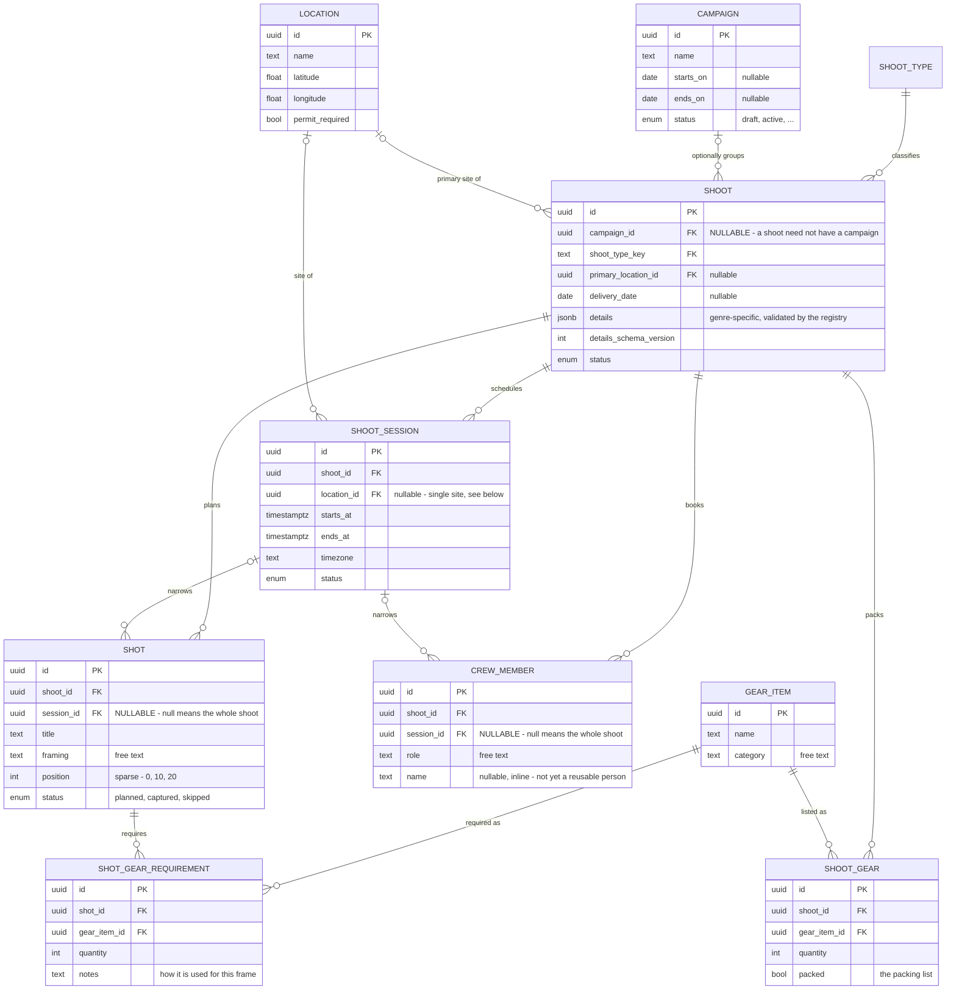

# Architecture

How Point of Focus is put together, and why. For how to run it, see the
[README](README.md).

- [Shape](#shape)
- [Data model](#data-model)
- [Tenant isolation](#tenant-isolation)
- [Portability](#portability)
- [Stack](#stack)
- [Repository layout](#repository-layout)

## Shape

A **modular monolith**, organised as vertical slices by bounded context, with a
hexagonal seam only at the external edges.

```
Request → oRPC procedure (authn, build TenantContext, validate)   ← thin adapter
        → core/modules/<ctx>/service.ts      ← all business rules
        → core/modules/<ctx>/repository.ts   ← Drizzle, always via withTenant()
        → Postgres (row-level security as the backstop)
```

Business logic never lives in route handlers or server actions. That is what
lets the web UI, a future mobile app and any future public API reach identical
behaviour through one path — and what keeps the transport replaceable, since
procedures are thin adapters rather than the place decisions are made.

Ports exist for exactly four things, because exactly these four have real swap
or test pressure: storage, weather, mail and the job queue. The database is
deliberately **not** behind a port — repositories are the abstraction, and tests
run against a real Postgres anyway.

## Data model

What exists today. Entities not yet built are listed at the end of this
section rather than drawn, so the diagram never shows something you cannot
query.

Every entity below carries `workspace_id`, `created_at`, `updated_at` and
`deleted_at` — with one deliberate exception: `SHOOT_TYPE` is global reference
data shared by all workspaces, so it has no `workspace_id` and no row-level
security policy. The workspace itself is **not** drawn: it is the parent of
everything else here, and an edge to each would turn the diagram into a star
with no readable shape. See [Tenant isolation](#tenant-isolation) for what that
column does.



### The decisions worth knowing

**Campaign is an optional parent.** `shoot.campaign_id` is nullable, so a
landscape photographer planning one sunrise shoot is never forced to invent a
campaign around it. Shoot — not campaign — is the aggregate root, and anything
that belongs to the work belongs to the shoot. Campaign-level views are a join
through `campaign_id`, not a second ownership path.

**Shots, crew and gear attach at either level.** Each carries
`shoot_id NOT NULL` plus a nullable `session_id`, where null means "the whole
shoot". A gear list is usually per-shoot; a shot list is usually per-session;
both need the other case sometimes. The composite foreign key includes
`shoot_id`, so the database rejects a child pointing at a session belonging to
a _different_ shoot — not merely one in another workspace.

**`SHOOT_GEAR` and `SHOT_GEAR_REQUIREMENT` are different questions.**
`shoot_gear` is the packing list: what goes in the bag, which is why it has
`packed`. `shot_gear_requirement` is planning: this frame needs the 85mm. You
pack once for the day, not per frame — so the same lens can sit on the packing
list and be required by three separate frames, and removing it from the bag
does not un-require it. The deliberately un-abbreviated name keeps it from
being confused with `shoot_gear`, which differs by one letter and carries the
same columns.

**Genre data lives in `details` jsonb, not in per-genre tables.** Anything
cross-genre or queryable is a real column; `details` holds only genre-specific
trivia, validated by the Zod registry in `packages/schemas/src/shoot-types`.
When a field proves cross-genre it is promoted to a column in a normal
migration — that promotion path is what keeps the jsonb from rotting.
`shoot_type` is a reference **table**, not an enum, so adding a genre is an
INSERT rather than a migration and a deploy.

**Free text where nothing branches.** `crew_member.role`, `gear_item.category`
and `shot.framing` are text, not reference tables. Real crews invent roles and
genres invent framing vocabulary; nothing in the system reads these values, so
constraining them would buy a migration every time someone needs a word we did
not think of. The UI offers suggestions instead.

### Not yet built

| Relationship                              | Status                                                                                                                                                                                                                            |
| ----------------------------------------- | --------------------------------------------------------------------------------------------------------------------------------------------------------------------------------------------------------------------------------- |
| `SESSION }o--o{ LOCATION`                 | Today a session has **one** nullable `location_id`. A location is already reusable across sessions, but a session cannot yet have several — which the landscape and trip cases need. Becomes a join table with an explicit order. |
| `PERSON` as its own entity                | `crew_member` stores `name` and `role` as inline text, so "Alex, MUA" cannot be reused across shoots or carry contact details and history.                                                                                        |
| `DELIVERABLE`                             | `shoot.delivery_date` exists as a single column; named deliverables with their own due dates and statuses do not.                                                                                                                 |
| `MEDIA`, `MOODBOARD`, `SHOT }o--o{ MEDIA` | Waits on Phase 2 storage — an asset table without an upload pipeline is dead weight.                                                                                                                                              |
| `SESSION_TEMPLATE`                        | Phase 4, and the product differentiator: reusable prep blueprints applied by copy, with provenance.                                                                                                                               |

## Tenant isolation

Enforced in three layers, because no single one is sufficient:

1. **Schema** — every domain table carries `workspace_id`, and child tables use
   composite `(workspace_id, id)` foreign keys, so the database structurally
   rejects cross-tenant references.
2. **Application** — service code cannot obtain a bare database handle. The only
   way to query is `withTenant`, which opens a transaction and sets the
   workspace GUC that the policies read.
3. **Database** — `FORCE ROW LEVEL SECURITY` on every domain table. The
   application connects as an unprivileged role that does not own the tables, so
   policies genuinely apply to it.

Layer 3 exists _because_ layer 2 can be bypassed by mistake. A query that
escapes `withTenant` matches zero rows rather than every row — it fails closed.

A [test suite](packages/db/src/testing/tenant-isolation.test.ts) walks every
registered domain table and asserts each of these. Registering a table without a
probe is a compile error.

Authentication tables are deliberately outside this regime: Better Auth must
resolve a session token and a user's organization list _before_ any workspace
context exists, so a tenant policy there would make login impossible. Tenant
isolation begins at the domain tables.

### Where it could still leak

Worth knowing when adding code:

- **Background jobs run outside request context.** Every job payload must carry
  `workspaceId` and open `withTenant`; a worker has no session.
- **Object storage is not covered by RLS.** Keys embed `workspaceId`, and
  signed-URL issuance re-checks the row before signing.
- **Cache keys** must include the workspace, or switching workspace serves the
  previous tenant's data from cache.
- **The client's active organization is a request, not a fact.** It is honoured
  only after membership is confirmed server-side.

## Portability

No vendor primitives. Postgres and an S3-compatible bucket are the entire
infrastructure; background jobs and cron live inside Postgres via pg-boss, so
there is no Redis and no platform scheduler. The stack is containerised and runs
unchanged on any container host — the deployment target is deliberately an
unmade decision.

Two consequences that are easy to undo by accident:

- **Next.js framework caching is off.** ISR and the data cache default to
  per-instance memory and disk, so across containers `revalidateTag()`
  invalidates only one. This is a logged-in, per-tenant tool where almost
  nothing is cacheable across users, so the cache buys close to nothing while
  costing a shared-cache dependency.
- **The storage port is expressed as intent, not S3 vocabulary.** Azure Blob is
  not S3-compatible; if `PutObjectCommand` or a presigned-PUT string leaks into
  the domain or a component, an Azure adapter becomes a rewrite rather than an
  adapter.

## Stack

| Concern    | Choice                                                             |
| ---------- | ------------------------------------------------------------------ |
| Monorepo   | pnpm workspaces + Turborepo                                        |
| Web        | Next.js 16 (App Router)                                            |
| API        | oRPC — one set of procedures serving a typed client _and_ OpenAPI  |
| Database   | Postgres 18 + Drizzle                                              |
| Auth       | Better Auth (self-hosted) with the organization plugin             |
| Validation | Zod 4, shared between server, web and future mobile                |
| Jobs       | pg-boss — queue, retries and cron inside Postgres                  |
| Testing    | Vitest + Testcontainers (real Postgres, real migrations, real RLS) |

oRPC over tRPC specifically because the same procedures serve both a fully-typed
client and a generated OpenAPI surface, with no hand-written parallel layer.

Better Auth is self-hosted rather than using a hosted identity provider: every
domain row is keyed by `workspace_id` referencing `organization.id`, so moving
off a vendor later would mean re-keying the entire schema.

## Repository layout

```
apps/
  web/        Next.js app (marketing + application)
  worker/     background jobs and cron
packages/
  core/       domain modules — services, repositories, ports
  db/         Drizzle schema, migrations, withTenant, RLS
  api/        oRPC contract and routers
  api-client/ typed client — shared with future mobile
  schemas/    Zod schemas — shared with future mobile
  ui/         React components (web only)
  config/     environment validation
```

`packages/schemas` and `packages/api-client` are kept free of Node-only imports
so a React Native app can bundle them unchanged. A CI job fails the build if
either one imports a Node builtin at runtime — catching it on the commit that
introduces it rather than months later during the mobile build.
